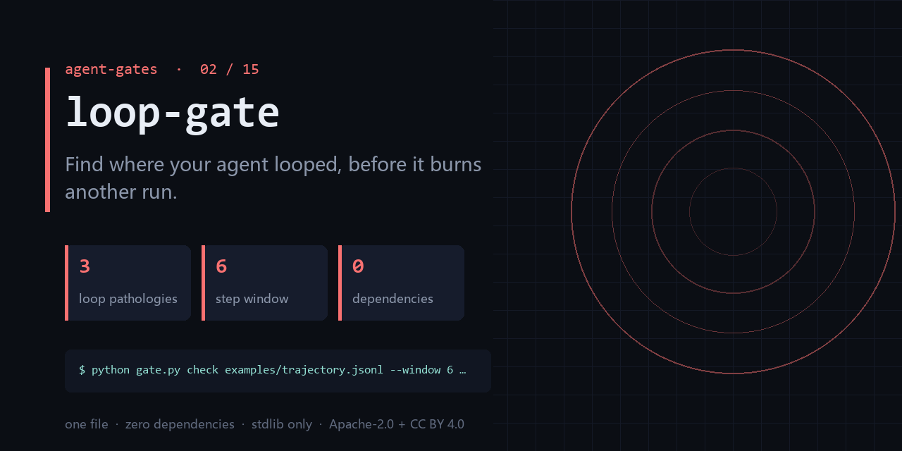

<div align="center">

</div>

<h1 align="center">loop-gate</h1>

<p align="center"><b>Find where your agent looped, before it burns another run.</b><br><sub>one file · zero dependencies · stdlib only</sub></p>

<p align="center"><a href="https://github.com/chenhz01/loop-gate/actions/workflows/gate.yml"></a>   </p>

---

## The failure this catches

- A single task ran 40 minutes and the bill was 10x normal — the same tool was called 11 times.
- The agent kept re-reading the same file, saying 'let me check once more', and changed nothing.
- After the incident you opened a 400k-line trace and could not find where the circling started.

One command, on a file you already have:

```bash
python gate.py check examples/trajectory.jsonl --window 6 --repeat-threshold 3
```

<details>
<summary><b>Real output</b> — produced by the bundled <code>examples/</code>, not a mock-up</summary>

```text
analyzed 11 step(s), 2 finding(s); breaker: halt (stasis or cycle detected; retrying burns tokens)
STASIS       turns=[5, 11] identical step repeated 7 times — halt: agent is stuck emitting the same step
EXACT_REPEAT turns=[5, 6, 7] signature repeated 3 times within a 6-step window — backoff: raise repeat threshold or vary the prompt
```

</details>

## What it does

- Detects three offline pathologies: repeating action, stasis, and revisit cycle.
- Works on any JSONL trajectory — your own schema maps in with a 10-line adapter.
- Exits 0 when clean and 1 when it finds something, so CI can branch on `$?`.

## What it does **not** do

- It does not intercept live calls — it reads what already happened.
- It does not judge whether the loop was *necessary* (retry-until-success looks the same).
- It does not parse provider-specific trace formats out of the box.

Being explicit here is cheaper than a wrong expectation later.

## Exit codes

`0` = no pathology. `1` = a loop pathology was found **or** the input could not be read (it prints `error: cannot read …` first). `2` = bad usage. Gate your pipeline on `$?`.

## Install

```bash
git clone https://github.com/chenhz01/loop-gate
cd loop-gate
python gate.py --help
```

Python 3.9+. Nothing to `pip install` — stdlib only.

## Use it in CI

```yaml
- name: loop-gate
  run: python gate.py check examples/trajectory.jsonl --window 6 --repeat-threshold 3
```

## Use it as a GitHub Action

`action.yml` is included, so you can call this repo directly as a composite action.

```yaml
# .github/workflows/gates.yml
- uses: actions/checkout@v4

- uses: chenhz01/loop-gate@v0.1.3
  with:
    # IMPORTANT: this path is inside YOUR repository.
    # The examples/ in this repo are NOT in your workspace — pass your own files.
    args: "check path/to/trajectory.jsonl --window 6 --repeat-threshold 3"
```

Pin the tag (`@v0.1.3`) rather than `@main` — `main` moves.
Check [Releases](https://github.com/chenhz01/loop-gate/releases) for the newest tag; `v0.1.0` predates the
fix that makes a mistyped path fail instead of silently passing.

If you omit `args`, the action only prints help and exits 0. It raises a warning
annotation — quoting this gate's own correct usage — so a green check is never
mistaken for "it inspected my files".


## 中文速览

**死循环门** — 在 Agent 再烧掉一轮预算之前，找出它在哪里绕圈。

- 一次任务跑了 40 分钟，账单是平时的 10 倍，日志里同一个工具被调了 11 次。
- Agent 反复读同一个文件、反复「再检查一下」，最后什么也没改。
- 出错后你去复盘，40 万行的 trace 里看不出它是什么时候开始转圈的。

一行命令：`python gate.py check examples/trajectory.jsonl --window 6 --repeat-threshold 3`

边界：It does not intercept live calls — it reads what already happened.

## The gates

| # | gate | what it stops |
|---|---|---|
| 02 | **loop-gate** ← you are here | Find where your agent looped, before it burns another run |
| 03 | **[permission-gate](https://github.com/chenhz01/permission-gate)** | Score how much more your agent can do than it should |
| 04 | **[context-gate](https://github.com/chenhz01/context-gate)** | Measure what truncation deletes, before the model starts guessing |
| 05 | **[instruction-gate](https://github.com/chenhz01/instruction-gate)** | Two of your instructions contradict each other. This finds them |
| 06 | **[output-gate](https://github.com/chenhz01/output-gate)** | Before AI-written text ships, run the four checks it always fails |
| 07 | **[memory-expiry-gate](https://github.com/chenhz01/memory-expiry-gate)** | Give every memory a TTL, then prove the expiry semantics actually hold |
| 08 | **[drift-gate](https://github.com/chenhz01/drift-gate)** | When embeddings drift, retrieval quietly rots. Fingerprint it |
| 09 | **[price-gate](https://github.com/chenhz01/price-gate)** | Your cost model is only as good as the price table under it |
| 10 | **[complexity-ceiling](https://github.com/chenhz01/complexity-ceiling)** | Per-file complexity budgets that fail the build instead of the reviewer |
| 11 | **[deadcode-gate](https://github.com/chenhz01/deadcode-gate)** | Quantify how much of the repo is dead, instead of guessing |
| 12 | **[docrot-gate](https://github.com/chenhz01/docrot-gate)** | Docs don't die at once. They rot one stale command at a time |
| 13 | **[leak-gate](https://github.com/chenhz01/leak-gate)** | Scan for internal detail before the doc leaves the building |
| 14 | **[backup-gate](https://github.com/chenhz01/backup-gate)** | A backup you have never verified is a rumor |
| 15 | **[trail-gate](https://github.com/chenhz01/trail-gate)** | Hash-chained agent audit trail — and it verifies its own chain |

## License

- Code: **Apache-2.0** — see [LICENSE](LICENSE)
- Docs and example data: **CC BY 4.0** — see [LICENSE-SPEC](LICENSE-SPEC)

Attribution required when you redistribute the documentation; code can be used commercially
without a separate agreement. See [NOTICE](NOTICE).
